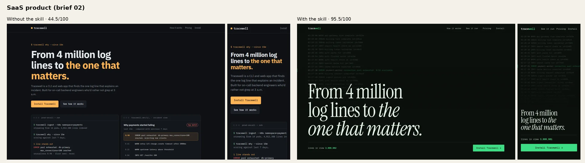
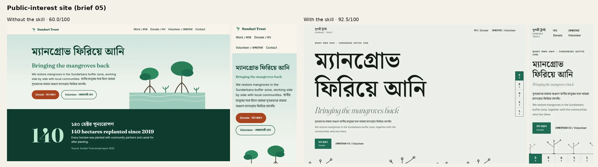
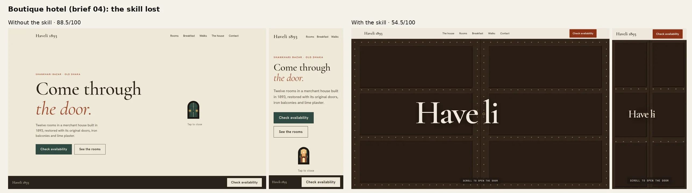

# Benchmark summary

Current result: <!-- current-report -->[`evals/results/2026-10-12-benchmark-v3.md`](../evals/results/2026-10-12-benchmark-v3.md)<!-- /current-report --> (benchmark v3, 2026-10-12). v2 and v1 are kept below as history, failures included. `scripts/check-repo.mjs` fails if the current report named here is not the newest main report in `evals/results/`.

## v3 (inside Claude Code, 2026-10-12) — current

Full report: [`evals/results/2026-10-12-benchmark-v3.md`](../evals/results/2026-10-12-benchmark-v3.md). Runner output: `evals/results/2026-10-12-benchmark-v3/summary.json`. Companion reports: [motion briefs](../evals/results/2026-10-12-benchmark-v3-motion.md) · [competitor skills](../evals/results/2026-10-12-benchmark-v3-competitors.md) · [Codex](../evals/results/2026-10-12-benchmark-v3-codex.md). Commit tested: `6f2724f`.

### What was compared
Five briefs × three seeds × four arms = 60 builds in Claude Code, one generator model (`claude_sonnet_5_5`), judged blind in pairs by GPT-5.4 and Gemini 3.1 Pro against `evals/rubric.md`. Arms: baseline (no skill), baseline + `gate.mjs` only, matched-effort baseline (told to refine for about the skill's median turn count), skill. Measurement (Playwright Chromium + axe-core + `gate.mjs`) ran on GitHub Actions.

### Scores (gated, /100; raw in brackets)

| Pair (A vs B) | B wins–losses–ties (of 15) | Mean gated A → B | Mean raw A → B | Sign test |
|---|---|---|---|---|
| Baseline vs Skill | 12–2–1 | 43.4 → 83.7 | 62.8 → 88.9 | p≈0.013 |
| Baseline + gate vs Skill | 14–1–0 | 65.5 → 86.4 | 65.5 → 91.4 | p≈0.001 |
| Matched effort vs Skill | 10–5–0 | 63.7 → 80.4 | 77.3 → 85.5 | p≈0.30 (not significant) |
| Baseline vs Baseline + gate | 9–6–0 | 46.4 → 68.3 | 73.0 → 68.3 | — |
| Baseline vs Matched effort | 12–0–3 | 43.1 → 70.6 | 66.0 → 86.3 | p≈0.0005 |

Companion results: competitor skills lost to the skill 14–1 (taste-skill), 14–1 (ui-ux-pro-max) and 11–3–1 (frontend-design). On Codex (5 briefs × 1 seed) the skill won 3–2 but the means were level (gated 77.0 baseline vs 76.2 skill).

### What it means
- The skill wins against a plain baseline and against the gate alone; the gate is about half the win (it removes hard-gate failures but doesn't improve design).
- Against a baseline told to work longer, the skill still leads (10–5) but the result is **not significant** with 15 pairs.
- **On motion judged alone, the skill lost.** In the Tier 4 motion briefs, judges scoring only the gate's frame strips preferred the baseline in 6 of 9 seeds (77.3 vs 64.4); the reduced-motion fallback scored 2.50 vs 4.39.
- On Codex the skill shows no measurable gain (n=5).

### Failures kept
- Pairs the skill lost: architecture s7101 and s7103 (to baseline); ceramics s3103 (to gated, the skill page fails contrast on dimmed scroll steps); architecture s7101, hotel s4103 and all three ceramics seeds (to matched effort).
- 10 pages failed a measured hard gate (6 baseline, 1 skill, 3 matched), all on axe contrast.
- `gate.mjs` passed the ceramics s3103 skill page that axe failed (dimmed inactive scroll steps); fixed in v2.5.0 by inactive-step sampling.
- Shared memory log across skill runs (run folders inside the repo walked up to the repo's `.motomation/`).

### Why this may overstate the skill
Small samples (15 pairs); judges saw a short summary of measured checks, which can favour arms that ran the gate; the matched arm under-used its budget (median 11 of about 19 turns); one agent and one generator model for the main arms; judges are models, not human designers; the model adapters used for the run (`evals/adapters/pplx-llm.py`, `anthropic-bridge.py`, `responses-bridge.py`) need a private SDK, so generation and judging can't be rerun outside that environment (re-scoring from the committed judgments can: `node evals/run-agent-benchmark.mjs score`).

## v2 (inside Claude Code, 2026-10-11) — history

Full report: [`evals/results/2026-10-11-benchmark-v2.md`](../evals/results/2026-10-11-benchmark-v2.md). Runner output: `evals/results/2026-10-11-benchmark-v2/summary.json`.

### What was compared
Five briefs (02, 03, 04, 05, 07) × three seeds × two conditions = 30 runs, all built inside Claude Code by the same model (`claude_sonnet_5_5`).
- **Skill condition:** the skill was installed in `.claude/skills/`, and the prompt asked the agent to `/build` with the collision engine and to follow the Delivery Gate.
- **Baseline condition:** the same agent and tools, with the prompt "expert web designer, check your work".
- **Judging:** two blind judges from other model families (GPT-5.4, Gemini 3.1 Pro) scored each pair against `evals/rubric.md`.
- **Gates:** measured hard gates come from Playwright + axe-core and `gate.mjs`.

### Scores (gated, /100, mean of two judges, mean of three seeds)

| Brief | Without | With | Δ |
|---|---|---|---|
| 07 Architecture studio | 74.8 | 96.0 | +21.2 |
| 04 Boutique hotel | 0.0 | 91.7 | +91.7 |
| 03 Ceramics shop | 47.3 | 93.2 | +45.8 |
| 02 Developer tool (SaaS) | 40.0 | 93.2 | +53.2 |
| 05 Climate non-profit | 67.3 | 88.0 | +20.7 |
| **Mean** | **45.9** | **92.4** | **+46.5** |

Without gates (raw), the means are 67.1 vs 92.4. The skill won 15 of 15 pairs on both measures. Five baseline pages failed the measured contrast gate (hotel ×3, ceramics 3103, SaaS 2102). No skill page did.

### What it means
- Inside an agent that can read its files and run its scripts, the skill won every pair. It also won the two briefs it lost in v1, on every seed.
- The v1 craft failures (caption contrast, 375 overflow) didn't recur: `gate.mjs` measured c0 o0 on all six studio and hotel skill pages.
- The "wrong value during animation" class did recur, in a new form: public 5102 shows a scrubbed counter at 0 mid-scroll. `gate.mjs` doesn't catch this.

### Why this may overstate the skill
- **Effort isn't matched.** Skill runs used a mean of 33.5 turns; baseline runs used 3–12.
- **The judges saw the measured checks.**
- **Ceiling effect.** Gemini gave 100 to 6 of the 15 skill pages.
- **Motion judged from stills.** The full-page shots don't trigger scroll reveals.
- **One agent, one model.**

### Failures kept
- Six runs died on an upstream API error and were re-run from scratch with the same seed.
- The public 5102 counter (above).
- An unconfirmed judge claim on public 5101.
- A keyboard-pattern false positive, fixed for both conditions before scoring.
- Two skill pages stamped H4 from their own measured focal tie.

## v1 (single prompt, 2026-10-11)

Full report with every screenshot, score and measurement: [`evals/results/2026-10-11-benchmark.md`](../evals/results/2026-10-11-benchmark.md).

### What was compared
The same model (`claude_sonnet_5_5`, same settings) built five briefs twice. The baseline got the brief alone. The skill run got the brief plus the Motomation skill and its `/invent` output. Two blind judges from other model families (GPT-5.4, Gemini 3.1 Pro) scored each pair with `evals/rubric.md`. Hard gates were applied from Playwright + axe-core measurements.

### Scores (gated, /100, mean of two judges)

| Brief | Without | With | Δ |
|---|---|---|---|
| Studio portfolio (07) | 81.5 | 0.0 | -81.5 |
| Boutique hotel (04) | 88.5 | 54.5 | -34.0 |
| E-commerce product (03) | 0.0 | 88.0 | +88.0 |
| SaaS product (02) | 44.5 | 95.5 | +51.0 |
| Public-interest (05) | 60.0 | 92.5 | +32.5 |
| **Mean** | 54.9 | 66.1 | +11.2 |

Mean axis scores over the five briefs (1–5, before gates):

| Axis | Without | With |
|---|---|---|
| Concept | 3.5 | 4.5 |
| Originality | 2.9 | 4.7 |
| Typography | 3.5 | 4.4 |
| Motion | 3.1 | 3.9 |
| Craft | 3.6 | 3.9 |
| Access & performance | 3.8 | 2.9 |

### Before and after

SaaS: a generic template that overflows on a phone, vs the Console archetype, where the terminal session is the page.

Public-interest: a conventional layout vs a bilingual manifesto that keeps the single real figure with its source.

Hotel, where the skill lost: the door-split hero breaks the name into "Have li", the page overflows the phone by 105px, and room prices flip through wrong digits.

### What it means
- The skill reliably moved structure, originality and typography. On Originality it scored higher on 4 of 5 briefs.
- It did not reliably improve craft. In 2 of 5 briefs it shipped defects that its own delivery gate lists (contrast, mobile overflow, motion that misstates content). Without a browser in the loop, the model stamps the gate as passed anyway.
- The release gate ("higher on every brief, no hard-gate failures") is **not met**.

### Failures (not fixed)
1. Release gate not met: the skill lost hotel (54.5 vs 88.5) and, after gates, studio (0 vs 81.5).
2. Self-critique stamps were identical across all five outputs (`C5 H4 S5 R4 M4 V5`, copied from the example) and don't track quality.
3. Signature IDs in stamps were invented, not taken from `data/signatures.csv`.
4. A measurement bug (closed cart drawer counted as "hidden under reduced motion") affected both e-commerce pages; it's disclosed and not used as a gate.
5. The same `/invent` seed was used for every brief, so mutations repeated across briefs (an artifact of the benchmark, not of a single run).

### Not verified
n = 1 per cell; one generator model; raw API calls, not an agent running the skill's scripts; motion judged from stills; the variety test was not run; the skill prompt is ~45k tokens longer than the baseline's.
