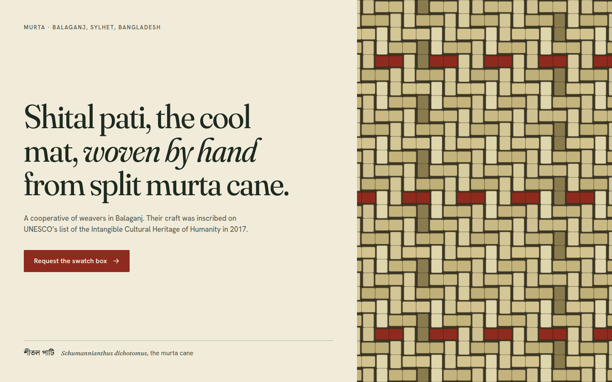
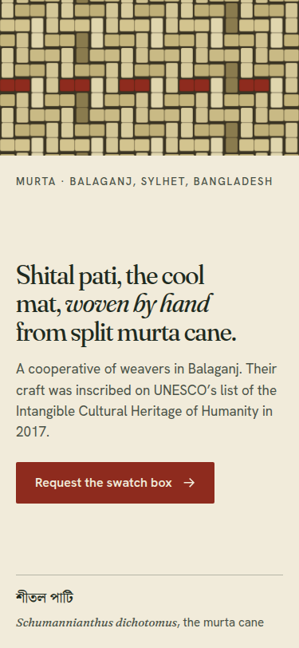

# Worked example: one hero section

A single-viewport hero for a real craft, built by Claude Code with the skill installed. Everything below is copied from the session: the prompt, the commands the agent ran, their output, the file it wrote and the gate's verdict. Nothing was edited except to shorten long outputs (marked `…`).

| | |
|---|---|
| Agent | Claude Code 2.1.286, headless (`claude -p`), model `claude_sonnet_5_5`, medium reasoning |
| Skill | v2.3.0 (commit `f6c7627`), installed at `.claude/skills/asfakulsiam-motomation-design` |
| Session | 17 turns, 7 min 20 s |
| Output | [`docs/examples/hero/index.html`](../../../../docs/examples/hero/index.html) · [`DESIGN.md`](../../../../docs/examples/hero/DESIGN.md) · [memory log](../../../../docs/examples/hero/log.json) |

## The prompt

```text
Use the asfakulsiam-motomation-design skill: /build a hero section only — one viewport, no other sections — as a single index.html.

Client: Murta, a cooperative of shital pati weavers in Balaganj, Sylhet, Bangladesh. Shital pati is a "cool mat" woven from split murta cane (Schumannianthus dichotomus); the craft was inscribed on UNESCO's list of the Intangible Cultural Heritage of Humanity in 2017.
Audience: interior designers and boutique-hotel buyers abroad who order in bulk.
The hero must say what the cooperative makes, in one line, and lead to one action: "Request the swatch box".
No photography is available. Do not invent statistics, prices or testimonials.
```

The cooperative's name is invented for the example. The craft, the plant name and the 2017 UNESCO inscription are real.

## What the agent did

1. Loaded the skill, then drew three collisions and checked the project memory:

   ```text
   $ node scripts/collide.mjs --n 3 && node scripts/memory.mjs recent
   COLLISION ENGINE
   Draw 1
     Archetype  : The Lookbook (lookbook): full-bleed editorial spreads page by page
     Mutation   : Invert the axis: vertical becomes horizontal or time runs backwards
     Collision  : rickshaw art (Dhaka street culture) → steal "bold painted panels and borders"
     …
   Draw 3
     Archetype  : The Poster (poster): one screen one image with layers beneath
     Mutation   : Remove the expected: no nav, no hero image or no grid
     Collision  : topographic map (geography) → steal "contour lines for height"
     …
   Diversity (measured)
     archetypes       : 3/3 unique  ✓
     signature seeds  : 3/3 unique  ✓
   No runs logged yet in this project (…/.motomation/log.json).
   ```

   It kept Draw 3's archetype and mutation (one screen, nothing expected) and replaced the collision with one from the brief itself: a loom's warp and weft.

2. Searched the data files for type and colour (`search.mjs fonts "craft warm bengali editorial"`, `search.mjs palettes "natural fibre earth"`), then checked every text pair with `contrast.mjs` before writing CSS:

   ```text
   $ node scripts/contrast.mjs "#1E2A20" "#F1EBDA"   → 12.5:1
   $ node scripts/contrast.mjs "#4A5247" "#F1EBDA"   → 6.8:1
   $ node scripts/contrast.mjs "#F1EBDA" "#8E2B1E"   → 7:1
   ```

3. Wrote `DESIGN.md` with the concept and the Restraint Gate record (below), then `index.html`.
4. Ran `node scripts/gate.mjs index.html`, pasted the stamp it printed, logged the run with `memory.mjs log`, then ran `--verify`.

## The concept, as written in `DESIGN.md`

```markdown
- **Tension:** a cooling, quiet, handmade object vs. a bulk buyer who needs proof of craft, with no photographs.
- **Concept sentence:** The page is the mat: the hero is plaited in front of you, strip by strip.
- **Archetype + mutation:** Poster, mutated by removing the expected (no nav, no hero image, no grid of cards).
- **Collision:** a loom's warp and weft (textile) lends the structure: a 2/2 twill drawn from strips.
- **Signature move:** Plait. Warp strips drop in and weft strips slide through, on a diagonal, once.
- **Dials:** ENERGY 1 · RHYTHM 1 · MOTION 1 → Tier 1
```

Type: Fraunces (display), Hanken Grotesk (text), Noto Serif Bengali for শীতল পাটি. Colour: ground `#F1EBDA`, ink `#1E2A20`, accent madder `#8E2B1E`.

## The output

| Desktop, 1440 × 900 | Phone, 375 × 812 |
|---|---|
|  |  |

The weave is the picture. There is no photo, so the agent drew one in SVG. The signature move is 12 lines of CSS:

```css
.weave .w{animation:plait-y .7s var(--ease-out) both;animation-delay:calc(var(--d)*16ms + 120ms)}
.weave .f{animation:plait-x .7s var(--ease-out) both;animation-delay:calc(var(--d)*16ms + 120ms)}
@keyframes plait-y{from{opacity:0;transform:translateY(-14px)}to{opacity:1;transform:none}}
@keyframes plait-x{from{opacity:0;transform:translateX(-14px)}to{opacity:1;transform:none}}
@media (prefers-reduced-motion:reduce){
  .weave .w,.weave .f{animation:none}
  .btn,.btn svg{transition:none}
}
```

`--d` is set per strip to `column + row`, so the plait runs on a diagonal and then stops. Under reduced motion, the mat is already woven. The weave is `aria-hidden`; the headline, one sentence and one button carry the content.

## What the Restraint Gate rejected

From the `Restraint Gate record` in `DESIGN.md`:

```markdown
- Concept survived: yes
- Cut: nav bar and logo wall: one action only, per the brief
- Cut: stats, prices, testimonials: none supplied, none invented
- Cut: pointer-reactive strips: a second signature
- Rejected animation: looping shimmer on the weave: tells the visitor nothing
- Rejected animation: fade-up on the headline: decoration, and it would delay the first read
```

## The gate result and the stamp

The gate the agent ran (v2.3.0, `gate/1`):

```text
DELIVERY GATE · /home/user/workspace/runs/hero/index.html
  contrast  ✓ 0 below AA  (8 text elements measured against rendered pixels; 1 skipped; 0 not visible at scan time)
  overflow  ✓ 0 at 375/390/768/1440px
  words     ✓ 0 display-text problems at 375px  (1 display elements checked)
  motion    ✓ 0 text elements hidden only under reduced motion; pixels changing on a still page: 0%  (9 compared)
  names     ✓ 0 missing alt / accessible names  (2 interactive elements checked)
  hierarchy  h1×1, 0 skipped heading levels, 1 element(s) tied for largest on the first 375px screen
  structure  2 sections, entrances: static | static → 0 repeat(s); pins 0, WebGL canvases 0, JS 2KB gzipped
  records    DESIGN.md: …/DESIGN.md · memory log: none · stamp fields: {"archetype":"poster","mutation":"remove-the-expected","signature":"plait","tier":"1"}
  critique → C5[restraint:kept] H5[375:0] S5[last5:no-log] R5[cuts:3,anim:2] M5[t1:pins0/2,webgl0/1,js2/30KB,rm0] V5[entrance-repeats:0]
  PASS  stamp → critique: C5[restraint:kept] H5[375:0] S5[last5:no-log] R5[cuts:3,anim:2] M5[t1:pins0/2,webgl0/1,js2/30KB,rm0] V5[entrance-repeats:0] · gate: c0 o0 w0 rm0 a0 · gate/1 · c8ac3ce1cb
```

Then `--verify` **rejected** that stamp:

```text
STAMP REJECTED · critique says "… S5[last5:no-log] …" but the checks give "… S1[last5:archetype-reused,signature-reused,fp100] …"
```

The agent reported this rather than hiding it. The cause was a gate bug: the agent logged the run without `--tier`, and `--verify` then compared the page with its own log entry and scored variety 1. It is fixed in v2.4.0 (commit `fc77175`). The same files, re-stamped and verified with the v2.4.0 gate ([full output](../../../../docs/examples/hero/gate-v2.4.txt)):

```text
  contrast  ✓ 0 below AA across 375/390/768/1440px  (measured against rendered pixels at each width)
  …
  numbers   ✓ 0 values shown wrong before they settle  (1 numbers checked at scroll 0, scroll end and reduced motion; 0 live values skipped)
  PASS  stamp → critique: C5[restraint:kept] H5[375:0] S5[last5:none] R5[cuts:3,anim:2] M5[t1:pins0/2,webgl0/1,js2/30KB,rm0] V5[entrance-repeats:0] · gate: c0 o0 w0 rm0 a0 n0 · gate/2 · 9848a24dad
STAMP VERIFIED · critique and gate numbers match a fresh scan · gate PASS
```

The stamp in the file, and where each value comes from:

```css
/* motomation · archetype: poster · mutation: remove-the-expected · signature: plait · tier: 1 · critique: C5[restraint:kept] H5[375:0] S5[last5:none] R5[cuts:3,anim:2] M5[t1:pins0/2,webgl0/1,js2/30KB,rm0] V5[entrance-repeats:0] · gate: c0 o0 w0 rm0 a0 n0 · gate/2 · 9848a24dad */
```

| Value | Comes from |
|---|---|
| `C5[restraint:kept]` | `Concept survived: yes` in DESIGN.md |
| `H5[375:0]` | 375px hierarchy test: one h1, no skipped levels, one focal point, no display-word failures |
| `S5[last5:none]` | memory log has no earlier run to compare against |
| `R5[cuts:3,anim:2]` | 3 `Cut:` + 2 `Rejected animation:` lines (1 + 5, capped at 5) |
| `M5[t1:…]` | tier 1 budget: 0 pins, 0 WebGL, 2 KB of JS against 30 KB, reduced motion clean |
| `V5[entrance-repeats:0]` | both sections are static, so no entrance repeats |
| `c0 o0 w0 rm0 a0 n0` | contrast at four widths, overflow, display words, reduced motion, names, numbers |

## Run it yourself

```bash
npx skills add asfakulsiam/asfakulsiam-motomation-design
claude -p "$(cat prompt.txt)"     # the prompt above, saved as prompt.txt
node .claude/skills/asfakulsiam-motomation-design/scripts/gate.mjs index.html
```

The collision draw is random unless you pass a seed, so your archetype may differ. What should stay the same: one idea that comes from the material, one action, no invented facts, a designed reduced-motion state, and a stamp that `--verify` accepts.
