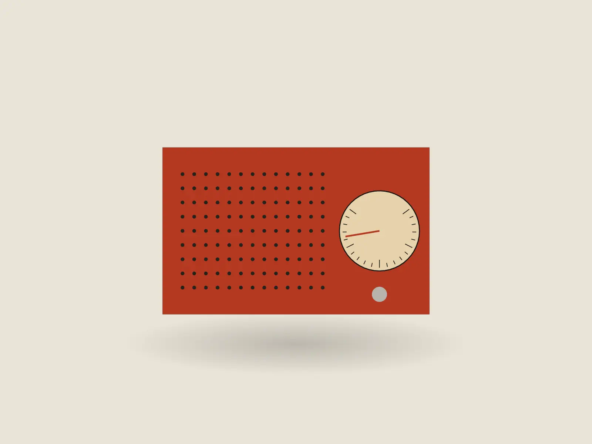
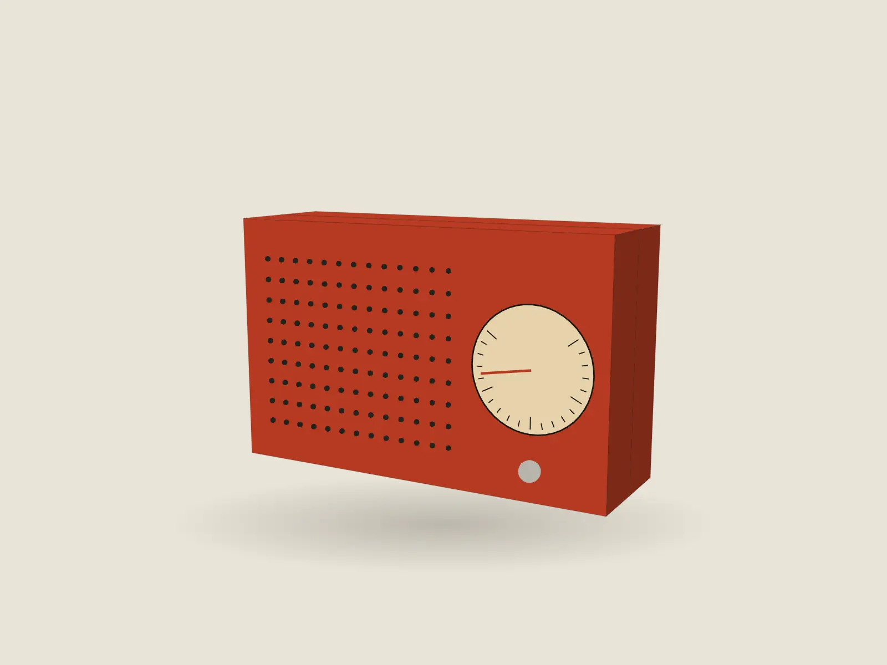
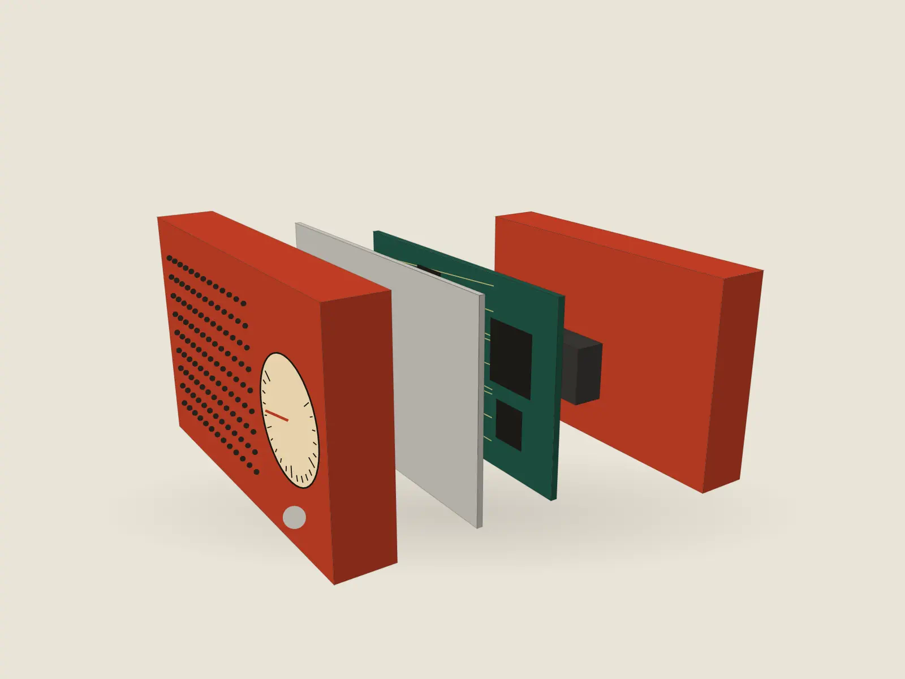
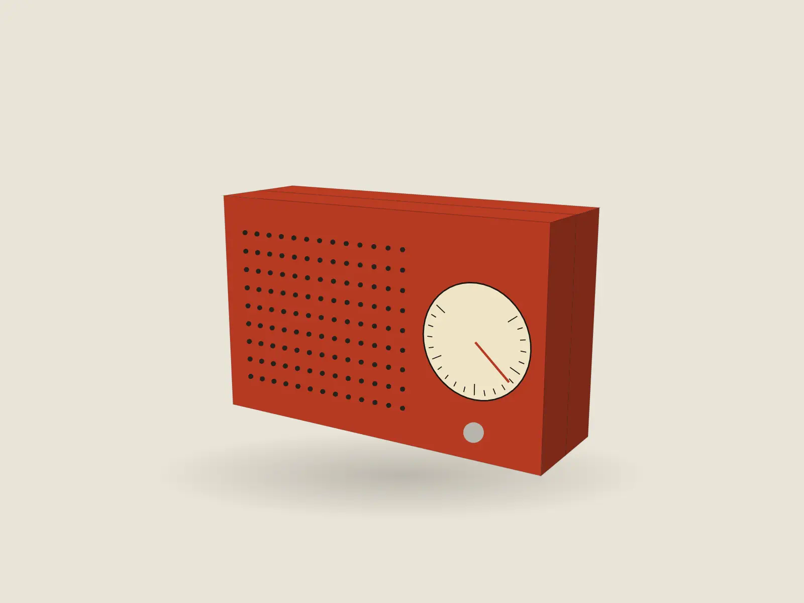

# Tier 5 showcase: one film page, every step

One Tier 5 (scroll-as-film) page followed through its pipeline: storyboard → timing sheet → frames → gate (with the Q motion-quality and A accessibility axes) → stamp → verification. The page is the `product-launch` template, "Shapla R1 · a kitchen radio you tune by hand". Every block below is real output from this repository at v2.5.0, run in a 2-CPU sandbox (Perplexity Computer, Playwright 1.59.0). Long output is shortened and marked `…`. Nothing is typed in by hand.

| | |
|---|---|
| Page | `examples/templates/product-launch/index.html`, standalone, 3 KB of JS gzipped, no libraries |
| Records | `DESIGN.md` (how it looks) · `MOTION.md` (timing sheet) · `scene.mjs` (the film) · `frames.json` (manifest) · `frames.lock.json` (where the frames live) · `log.json` (memory log the S axis was read against) |
| Gate | `gate/4`, PASS, stamp `99f3f9d14b`, `--verify`: STAMP VERIFIED |
| Frame-rate | Not measured here. A sandbox cannot judge smoothness; frame-rate evidence comes only from `.github/workflows/tier5-fps.yml` on GitHub runners, and this page has no fps figure in this document |

## 1. Storyboard

A Tier 5 page starts as four stills, not as code. The film is a pure function of scroll progress `p` (0 to 1), written in `scene.mjs`. Its header is the storyboard in words:

```text
// Scene for the product-launch template: "Shapla R1", a kitchen radio, turned and taken apart in five beats.
// Rendered to frames by scripts/build-frames.mjs (see its header for the contract). Pure: no Date, no Math.random.
//   01 Face     0.00–0.20  front-on, the camera pushes in a little (the page opens it through an aperture)
//   02 Profile  0.20–0.40  the radio turns to three-quarters (orbit)
//   03 Inside   0.40–0.70  the five layers separate along the depth axis (exploded view)
//   04 Closed   0.70–0.85  the layers come back together (assembly)
//   05 Tune     0.85–1.00  the dial needle sweeps to a station and the dial window warms (hold)
export const scene = { name: "product-launch · Shapla R1", desktop: [4, 3], mobile: [4, 5], stills: [0.1, 0.32, 0.6, 0.95], seed: 3 };
```

`stills: [0.1, 0.32, 0.6, 0.95]` picks one moment inside each step. The frame pipeline renders them at 1600px as the storyboard. The same four images are the reduced-motion page, so the storyboard is also the fallback:

| 0.10 Face | 0.32 Profile | 0.60 Inside | 0.95 Tune |
|---|---|---|---|
|  |  |  |  |

Sizes on disk: `storyboard/1.webp` 13,406 B · `2.webp` 17,546 B · `3.webp` 22,068 B · `4.webp` 18,518 B.

## 2. Timing sheet

`MOTION.md` turns the four stills into a scroll score. Ranges are percentages of the stage's pinned pass (440vh desktop, 360vh mobile, minus one viewport). The page is stepped, not a continuous scrub: each quarter moves the film for 70% and holds for 30%, so the radio stands still while its note is read. Chapter 2, verbatim:

```text
### Chapter 2: Stage (`.stage`, pinned) · 440vh · dense · technique: stepped frame sequence
| Beat | Range | Element | Action | Ease | Overlap | Camera | Reduced motion |
|---|---|---|---|---|---|---|---|
| 01 | 0–16% | film window | aperture: `circle(16%)` → `circle(75%)`, then unclipped | smoothstep | with 02 | — | no aperture; still 1 in flow |
| 02 | 0–17.5% (film 0–0.20, f1–36) | radio | front-on, the camera pushes in | ease-in-out cubic (scene) | with 01 | push | still 1 + note "Folded from one sheet" |
| 03 | 17.5–25% | — | hold on the front; step 1 note open | — | hold 7.5% | — | — |
| 04 | 25–42.5% (film 0.20–0.40, f36–72) | radio | turns to three-quarters, showing the 48 mm depth | ease-in-out cubic | after 03 | orbit | still 2 + note |
| 05 | 25% | step list | step 2 marked (ink, rule), its note opens | `--ease` 300ms | cut at 25% | — | all notes open |
| 06 | 42.5–50% | — | hold on the profile | — | hold 7.5% | — | — |
| 07 | 50–67.5% (film 0.40–0.70, f72–126) | radio | the five parts separate along the depth axis; the shadow widens | ease-in-out cubic | after 06 | orbit continues (−0.3 rad) | still 3 + note |
| 08 | 67.5–75% | — | hold on the exploded view | — | hold 7.5% | — | — |
| 09 | 75–92.5% (film 0.70–1.00, f126–180) | radio | the parts close up (0.70–0.85), then the needle sweeps to a station and the dial warms (0.86–0.97) | ease-in-out cubic | after 08 | orbit back (+0.42 rad) | still 4 + note |
| 10 | 92.5–100% | — | hold on the tuned radio; the page lets go | — | hold 7.5% | — | — |
```

The other three chapters (hook, specifications, order) are still. Rhythm: still · dense · still · still. `check-repo` checks the timing sheet of every Tier 3–5 template (the `timingSheet` rule in the repository's template rules, at the root of the repo rather than in the skill). A `MOTION.md` that is missing, or has no chapter header with a dense/still mark, no table with these eight columns and beat rows, or no `Rhythm:` line, fails the repository check.

## 3. Frames

`scripts/build-frames.mjs` renders `scene.mjs` in headless Chromium with the Canvas 2D API and encodes with ffmpeg. The manifest it wrote, `frames.json` (head shown):

```json
{
  "scene": { "file": "scene.mjs", "name": "product-launch · Shapla R1", "sha256": "9d433b691be2bdbf96fbb8315be8388dd2fe623a47a7c945f6f7498c21d92623", "seed": 3, "stills": [0.1, 0.32, 0.6, 0.95] },
  "desktop": { "frames": 180, "width": 1920, "height": 1440 },
  "mobile": { "frames": 90, "width": 828, "height": 1036 },
  "storyboard": { "width": 1600, "height": 1200 },
  "format": "webp", "quality": 64,
  "poster": "poster.webp (frame 0090 of 180)",
  "mp4": "film.mp4 (H.264, -g 1, 30 fps, crf 30)",
  "total_bytes": 6779419,
  "files": { "frames/0001.webp": "129976c59ae68fc63dbde96747d8fd0512ca97c54d33bcabd26374a57db9dde1", … }
}
```

"30 fps" in that line is the MP4's encoding rate, not a measured frame rate.

The 270 frames and the MP4 (6.8 MB) are not on `main`, which stays under 15 MB. `frames.lock.json` names the tarball and its sha256; `scripts/fetch-frames.mjs` downloads it, checks the hash and unpacks it:

```text
$ node scripts/fetch-frames.mjs --check
✓ motion-portfolio: 180/180 desktop, 90 mobile frames on disk
✓ product-launch: 180/180 desktop, 90 mobile frames on disk
```

The frames are reproducible. `--check` renders the scene again into a temporary folder and compares every file's hash with `frames.json`:

```text
$ node scripts/build-frames.mjs --scene examples/templates/product-launch/scene.mjs --out examples/templates/product-launch --check
build-frames: scene.mjs → (check) /tmp/frames-check-…
  frames: 30/180 … frames: 180/180
  frames-mobile: 30/90 … frames-mobile: 90/90
✓ deterministic: all 276 files byte-identical to …/examples/templates/product-launch/frames.json
```

This step found a bug while this document was being written. The first `--check` run printed:

```text
✗ not deterministic: 275 of 276 files differ (first: frames/0001.webp, frames/0002.webp, frames/0003.webp)
exit 1
```

The page's frames are encoded at `"quality": 64`, but `--check` rendered at the default of 70. Run again with `--quality 64`, every file was byte-identical (`✓ deterministic: all 276 files byte-identical`). Since v2.5.0, `--check` takes the frame counts, widths, quality and format from the manifest it checks against, so the plain command above compares like with like. A flag given on the command line still wins.

## 4. Gate

The full Delivery Gate, `gate/4`, on the built page. The Q axis (motion quality) and A axis (accessibility) are the gate/3 additions that matter most for a film page: Q screenshots the pinned zone at 8 scroll positions and fails a pin that doesn't progress, measures frame intervals, and requires reduced motion to be normal flow. A tabs through every focusable element, checks targets at 375, zooms to 200%, reflows at 320px, renders forced colours and looks for keyboard traps.

```text
$ node scripts/gate.mjs examples/templates/product-launch/index.html
gate: constrained machine (2 CPUs); a failed scan is retried once in the light footprint
DELIVERY GATE · examples/templates/product-launch/index.html
  contrast  ✓ 0 below AA across 375/390/768/1440px  (measured against rendered pixels at each width)
      375px  ✓ 0 below AA  (43 measured; 1 skipped; 0 not visible at scan time)
      390px  ✓ 0 below AA  (43 measured; 1 skipped; 0 not visible at scan time)
      768px  ✓ 0 below AA  (42 measured; 2 skipped; 0 not visible at scan time)
     1440px  ✓ 0 below AA  (43 measured; 1 skipped; 0 not visible at scan time)
  overflow  ✓ 0 at 375/390/768/1440px
  words     ✓ 0 display-text problems at 375px  (8 display elements checked)
  motion    ✓ 0 text elements hidden only under reduced motion; pixels changing on a still page: 0%  (41 compared)
  names     ✓ 0 missing alt / accessible names  (13 interactive elements checked)
  numbers   ✓ 0 values shown wrong before they settle  (15 numbers checked at scroll 0, scroll end and reduced motion; 0 live values skipped)
  progress  ✓ 0 of 1 pinned/scrubbed zone(s) static (median change between 8 scroll samples ≤ 0.5% of pixels)
     ✓ sticky div.pin  3060px  Δ median 16.5% · 7/7 transitions change  [18.18 5 9.37 20.68 16.51 24.88 1.66]
  smooth    – not verified — sandbox (sandbox: 2 CPUs); measured intervals … — see docs/adapters/sandbox.md
  rm-flow   ✓ reduced motion is normal flow, all text present · 0 visible canvas(es)
  focus     ✓ 0 of 13 focused elements show no visible focus indicator  (13 tabbable)
  targets   ✓ 0 under 24px, 6 under 44px (warning) at 375 touch  (9 checked; inline links exempt)
     114×25  a.skip  "Skip to content"
     58×33  a  "Shapla"
     230×30  a  "Folded from one sheet"
     127×30  a  "48 mm deep"
  zoom200   ✓ 0 lost at 200% (1440×900 → 720×450): text clipped or controls unreachable that were fine at 100%
  reflow    ✓ 0px horizontal scroll at 320px
  forced    ✓ 0 of 40 texts illegible in forced colors (rendered ink under 3:1 against its box, or no ink)
  kbd-trap  ✓ 13 of 13 tabbable reached in 32 Tabs, no cycle
  C copy     ✓ 0 rule(s) failing  (craft/copy.md; 0 warning(s))
  S SEO      ✓ 0 rule(s) failing  (craft/seo.md; 1 warning(s))
     ⚠ seo-10  no JSON-LD; add Product, Article, FAQ, Event or Organization where the page is eligible
  P perf     ✓ 0 rule(s) failing  (craft/performance.md; 0 warning(s))
  K security ✓ 0 rule(s) failing  (craft/security.md; 0 warning(s))
  composition (advisory: heuristics, never fail the gate, not in the stamp)
     pin fill  ✓ 1 of 1 pinned zone(s) at least 60% filled  (sticky div.pin 65%)
     focal     ⚠ 2 of 7 screen(s) with text have one clear focal point (heaviest text mass ≥ 1.5× the next); no clear lead on screen 2 (1.02×), 3 (1.02×), 4 (1.04×), 5 (1.05×), 6 (1.09×)
     scale     ✓ display:body 1:6.9  (123.84px / 18px; warn below 1:6)
  hierarchy  h1×1, 0 skipped heading levels, 1 element(s) tied for largest on the first 375px screen
  structure  6 sections, entrances: static | static | static | static | static | static → 0 repeat(s); pins 1, WebGL canvases 0, JS 3KB gzipped
  records    DESIGN.md: examples/templates/product-launch/DESIGN.md · memory log: examples/templates/product-launch/log.json · stamp fields: …
  critique → C5[restraint:kept] H5[375:0] S5[last5:archetype-new,signature-new,fp41] R5[cuts:3,anim:2] M5[t5:pins1/2,webgl0/1,js3/250KB,rm0] V5[entrance-repeats:0] Q5[prog:Δ16.5%,smooth:sandbox,rm:flow] A5[focus:13/13,tgt:0f6w,zoom:0,reflow:0,fc:0,trap:0]
  coverage   ✓ worst width 768px: 2 of 44 text elements skipped (5%; limit 30% at every width)
  PASS  stamp → critique: C5[restraint:kept] H5[375:0] S5[last5:archetype-new,signature-new,fp41] R5[cuts:3,anim:2] M5[t5:pins1/2,webgl0/1,js3/250KB,rm0] V5[entrance-repeats:0] Q5[prog:Δ16.5%,smooth:sandbox,rm:flow] A5[focus:13/13,tgt:0f6w,zoom:0,reflow:0,fc:0,trap:0] · gate: c0 o0 w0 rm0 a0 n0 q0 k0 · rules: C0 S0 P0 K0 · gate/4 · 99f3f9d14b · skipped 2/44@768

exit 0
```

What the output says about this page:

- **Q5**: the pinned stage changes in every one of its 7 sampled transitions (median 16.5% of pixels), so it's a film and not a frozen pin. Reduced motion is normal flow, with no pin and no canvas mounted. Smoothness is reported as `not verified — sandbox`: on a 2-CPU machine frame intervals are a fact about the machine, not about the page. The gate prints the measured intervals and doesn't judge them. This document doesn't turn them into a frame rate.
- **A5**: 13 of 13 tabbable elements show a focus ring. Nothing is under 24px at 375 (6 targets are under 44px, a warning, not a fail). Nothing is lost at 200% zoom, there's no sideways scroll at 320px, forced colours stay legible and there's no keyboard trap.
- **Composition (advisory)**: the v2.5.0 heuristics print here and never change the verdict (`gates/delivery-gate.md`, Part 0). The pinned stage is 65% filled at 1440, above the 60% line. The display:body scale is 1:6.9. The focal heuristic warns on screens 2–6: inside the stage, the step list and the open note weigh about the same as text, because the radio, which is the real focal point, is a canvas and has no text mass. That warning is a known limit of a text-mass heuristic on a film page, and it's why the block is advisory. The stamp id is unchanged by the block (`99f3f9d14b` before and after C4).

## 5. Stamp

The gate's last line is the stamp. It goes into the page unchanged. The stamp in `index.html` today:

```text
motomation · archetype: stage · mutation: single-object · signature: aperture · tier: 5 · critique: C5[restraint:kept] H5[375:0] S5[last5:archetype-new,signature-new,fp41] R5[cuts:3,anim:2] M5[t5:pins1/2,webgl0/1,js3/250KB,rm0] V5[entrance-repeats:0] Q5[prog:Δ16.5%,smooth:sandbox,rm:flow] A5[focus:13/13,tgt:0f6w,zoom:0,reflow:0,fc:0,trap:0] · gate: c0 o0 w0 rm0 a0 n0 q0 k0 · rules: C0 S0 P0 K0 · gate/4 · 99f3f9d14b · skipped 2/44@768
```

Read left to right:

- The design fields (archetype, mutation, signature, tier) come from `DESIGN.md`.
- Each critique axis carries the number it was derived from (`M5[t5:pins1/2,…]`: Tier 5, one pin of a budget of two, no WebGL, 3 of 250 KB of JS, nothing hidden under reduced motion).
- The gate counts are all zero.
- `99f3f9d14b` is a hash of what was measured on this exact page.
- `skipped 2/44@768`: at the worst width, 2 of 44 text elements could not be measured. The gate allows up to 30%.

From the repository root, `node scripts/build-templates.mjs --stamp product-launch "<line>"` writes the line into the page as printed (a leading `PASS stamp →` is stripped).

## 6. Verification

`--verify` reads the stamp, scans the page again from scratch and compares. The progression Δ may differ by a decimal between scans; everything else must match exactly.

```text
$ node scripts/gate.mjs --verify examples/templates/product-launch/index.html
…
  PASS  stamp → critique: C5[restraint:kept] H5[375:0] S5[last5:archetype-new,signature-new,fp41] R5[cuts:3,anim:2] M5[t5:pins1/2,webgl0/1,js3/250KB,rm0] V5[entrance-repeats:0] Q5[prog:Δ16.5%,smooth:sandbox,rm:flow] A5[focus:13/13,tgt:0f6w,zoom:0,reflow:0,fc:0,trap:0] · gate: c0 o0 w0 rm0 a0 n0 …

  stamp skips: 2/44@768 · fresh scan: 2/44@768 (5%)
STAMP VERIFIED · critique and gate numbers match a fresh scan · gate PASS
exit 0 291s
```

A hand-written or copied stamp fails here. It is rejected if it has no measured gate segment, no traced critique or the wrong gate version, or if its counts or id don't match the fresh scan (exit 2).

## What this example does not show

- **Frame rate.** Only `tier5-fps.yml` produces frame-rate numbers, on GitHub runners. It wasn't run for this document.
- **A real product.** Shapla is fictional. `DESIGN.md` lists the `[NEEDS ASSET]` items: the product's real turntable or exploded-view sequence through the same pipeline, and a real reservation endpoint.
- **The benchmark.** This is one page through the gate, not a comparison with or without the skill. See `docs/benchmark-summary.md` for that.
