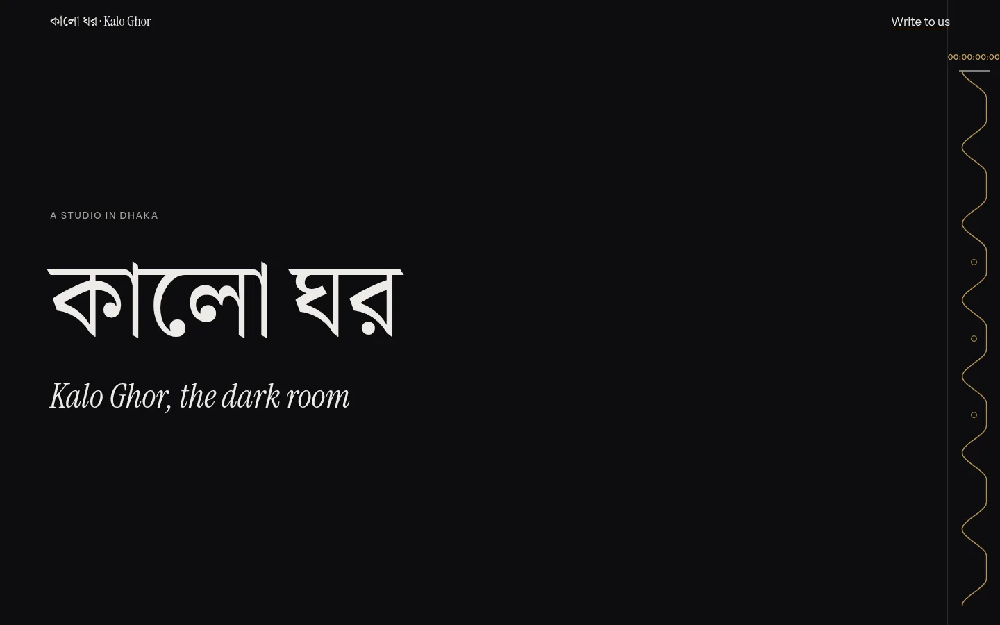
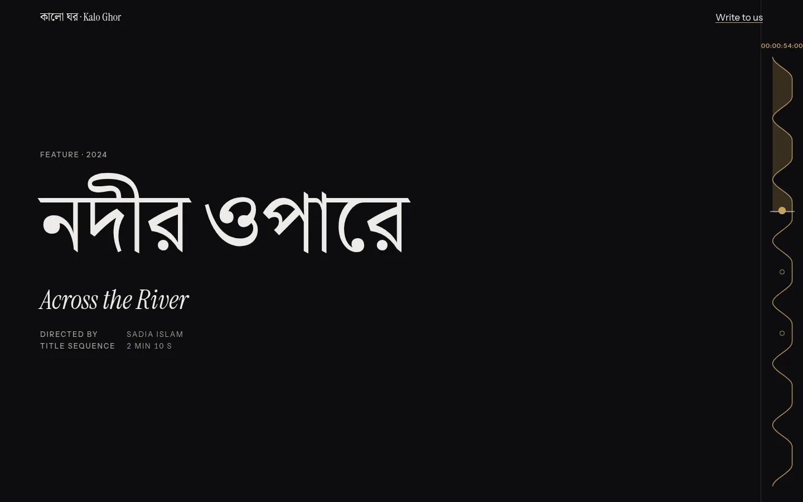
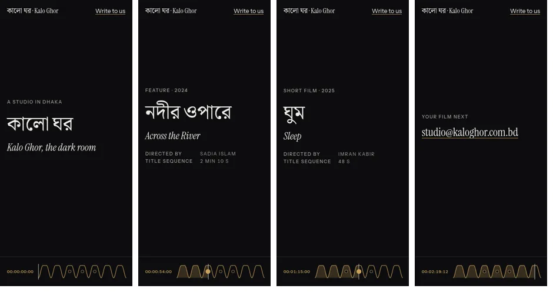
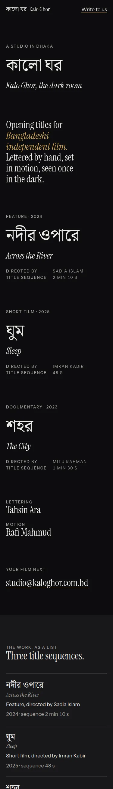

# Flagship example: one prompt, the whole skill

One page, built with every step of the full route: the brief read, the Thinking Sequence (7 steps), a real collision draw, the archetype, palette and fonts chosen from the CSV data, the motion tier decided, the signature move, an Anti-Sameness Check that **failed the first plan**, the Restraint Gate record, the build, the Delivery Gate, and a stamp whose every value comes from a check. Nothing in this file is described that didn't happen; each block below links to the raw output.

| | |
|---|---|
| Agent | Perplexity Computer (orchestrator model Claude Opus 5.5), following the skill by hand, every command run in a terminal |
| Skill | v2.4.0-dev, `gate/2`, Playwright 1.59.0, Chromium 1217 |
| Result | [`index.html`](../../../../docs/examples/showcase/index.html), one file, 3 KB of JS gzipped, no libraries |
| Records | [`prompt.txt`](../../../../docs/examples/showcase/prompt.txt) · [`collide.txt`](../../../../docs/examples/showcase/collide.txt) · [`search.txt`](../../../../docs/examples/showcase/search.txt) · [`search2.txt`](../../../../docs/examples/showcase/search2.txt) · [`contrast.txt`](../../../../docs/examples/showcase/contrast.txt) · [`thinking.md`](../../../../docs/examples/showcase/thinking.md) · [`DESIGN.md`](../../../../docs/examples/showcase/DESIGN.md) · [`memory-log.txt`](../../../../docs/examples/showcase/memory-log.txt) · [`gate.txt`](../../../../docs/examples/showcase/gate.txt) · [`verify.txt`](../../../../docs/examples/showcase/verify.txt) |



## The prompt

```text
Use the asfakulsiam-motomation-design skill: /build a one-page portfolio as a single HTML file (index.html). Use --seed 2430 for the collision engine.

Client: Kalo Ghor (কালো ঘর, "the dark room"), a two-person studio in Dhaka that designs opening titles for Bangladeshi independent films. Tahsin Ara draws the lettering; Rafi Mahmud animates it.
Work (Bangla title · English title · kind · director · year · length of the title sequence):
- নদীর ওপারে · Across the River · feature · Sadia Islam · 2024 · 2 min 10 s
- ঘুম · Sleep · short film · Imran Kabir · 2025 · 48 s
- শহর · The City · documentary · Mitu Rahman · 2023 · 1 min 30 s
Contact: studio@kaloghor.com.bd
Audience: film directors and festival programmers deciding who should title their next film.
No stills or video are available yet. Do not invent clients, awards, festival selections or numbers.
```

The studio, its people and its films are invented for this example; the prompt says so by giving every fact, and the page uses no others.

## Route

```text
Route: full. A new page with a concept, a signature and motion: every step runs.
```

## Step 0: read the room

Audience: directors and programmers, on a laptop between screenings, deciding in a minute. Job: show how this studio thinks about titles, then give one address. Mood: dark, patient, exact. Constraint that shapes everything: **there are no images.** A portfolio without stills has to make its type and its timing the work. Gaps: none blocking.

## Step 1–2: tension and concept

> **Tension:** opening titles are watched once, in the dark, for two minutes, before anyone knows the film ↔ a portfolio is read in daylight, skimmed in seconds.
>
> **Concept:** The page is an opening title sequence: scrolling plays the credits, and a running timecode tells you where you are in it.

## Step 3–4: the collision draw (real output)

```text
$ node scripts/collide.mjs --n 3 --spread --category studio --seed 2430
COLLISION ENGINE · category: Studio / Agency · seed 2430

Draw 1
  Archetype  : The Film Reel (film-reel): scroll is a timeline of scenes
  If it can't serve the brief, take: The Index (index), not a favourite
  Mutation   : Make the UI the content: the scrollbar is the timeline; the cursor is the product
  Collision  : tide chart (sea) → steal "periodic rise and fall"
               e.g. content density rising and falling with scroll
  Kinetic    : the whole page magnifies, driven by page exit
  Seed move  : Aperture: the next section opens through an iris or door
  Fingerprint: layout=sequence · tier=2 · signature_type=scroll

Draw 2
  Archetype  : The Specimen (specimen): the page is a type specimen
  Mutation   : Second person: the visitor becomes a character in the layout
  Collision  : film leader (cinema) → steal "countdown 3-2-1 before a reel"
  …
Draw 3
  Archetype  : The Manifesto (manifesto): one argument set large like a speech
  Mutation   : Borrow a print rule: marginalia, footnotes, folios or a colophon
  Collision  : elevator panel (architecture) → steal "floor numbers that light in sequence"
  …
```

**Chosen: Draw 1.** Draw 2's film-leader collision is cinema colliding with cinema, which is no collision at all. Draw 3's Manifesto suits an argument, and this studio has three films and an address, not an argument. Draw 1 fits the concept and its collision comes from an unrelated world (a tide table), which is what the engine is for.

- **Archetype + mutation:** The Film Reel, mutated by "make the UI the content": the scrollbar's job (where am I, how much is left) moves into the design as a timeline rail with timecode.
- **Collision:** tide chart → periodic rise and fall. Each credit rises, holds and falls away like a tide, and the rail draws the tide line: how much is on screen at each moment of the sequence.
- **Taken from the draw:** archetype, mutation, collision. **Not taken:** the kinetic (whole page magnifying on exit) and the seed move (Aperture), both cut in the Restraint Gate below.

## Step 5: signature move

The catalog already has a starting point ([`search.txt`](../../../../docs/examples/showcase/search.txt)):

```text
$ node scripts/search.mjs signatures "timeline timecode scrub"
■ timecode-rail  (score 4.54)   family scroll · tier 5 · one_line: a running timecode shows chapter progress
```

A running timecode alone is a progress bar with a film costume, and the catalog lists it at Tier 5. The collision changes what the rail shows, and the tier drops with it:

**The Tide Rail.** A rail at the screen edge draws the rise and fall of all the credits as one tide line, fills the part already played, carries a playhead and a running 24 fps timecode, and has one mark per film that you can press to jump to it. On phones it lies along the bottom edge.

## Palette and fonts from the data (real output)

The first searches pointed at the obvious answer:

```text
$ node scripts/search.mjs fonts "condensed cinematic film title display"
  → Big Shoulders Display (top, score 13.51) …
$ node scripts/search.mjs palettes "dark cinema black film"
  → Darkroom (top, score 6.90) …
```

That plan went into the Anti-Sameness Check (next step) and failed it. The replacements, also from the data:

```text
$ node scripts/search.mjs palettes "night river blue tide"     → Night Brass (top, 3.82)  #0D0D0F / #18181B / #EDEBE6 / #A3A09A / #C9A15B
$ node scripts/search.mjs fonts "serif display editorial titles" → Big Shoulders Display 3.57 (again), Instrument Serif 3.54: take the serif
$ node scripts/search.mjs fonts "bengali display"               → Noto Serif Bengali (top, 4.83)
```

Every pair checked before it was used ([`contrast.txt`](../../../../docs/examples/showcase/contrast.txt)):

```text
#EDEBE6 on #0D0D0F: 16.29:1  body PASS · large PASS · AAA PASS   ink on ground
#A3A09A on #0D0D0F:  7.44:1  body PASS · large PASS · AAA PASS   credit roles
#C9A15B on #0D0D0F:  8.07:1  body PASS · large PASS · AAA PASS   brass: rail, timecode, accent words
#A3A09A on #18181B:  6.79:1  body PASS · large PASS · AAA —      roles on the index surface
```

**Type mode: HOUSE STYLE.** A studio portfolio, where the type is the work. Bangla titles come first and largest, English beneath in italic, the way a bilingual credit is set.

## Step 6: Anti-Sameness Check (it failed first)

```text
Memory: no earlier run in this project.
AI-default scan: no hero → logos → features → testimonials; no centred headline with two buttons; no thumbnail bento;
  no "Our work" grid with play buttons. Clear.
Skill-example scan: FAIL. Film Reel + Big Shoulders Display + Darkroom is the worked example in thinking/sequence.md
  ("portfolio for a motion designer in Dhaka"): the same structure, type and colour, 3 of 6 dimensions.
  Every agent that reads this skill sees that example, and the top search results lead straight back to it.
Mutated:
  type      Big Shoulders Display → Instrument Serif + Noto Serif Bengali (credits in a serif, Bangla first)
  colour    Darkroom (safelight red) → Night Brass (projector brass on black)
  signature grease-pencil circles → the Tide Rail
Against the obvious version (a grid of video thumbnails with play buttons): differs in structure, type, colour,
  motion, signature and imagery (6 of 6).
```

This is the check doing its job: the plan that came straight out of the data was the skill's own example with the serial numbers filed off.

## Motion tier

Dials: ENERGY 2 · RHYTHM 3 · MOTION 2 → **Tier 2.** One pinned, scroll-scrubbed chapter carries the idea. Not Tier 3: there is one page, so there are no page transitions to design. Not Tier 4: nothing here is spatial, material or lit, and there are no images to distort. The motion uses `opacity` and `transform` only; the rail redraws one SVG path per frame and stops when the reel is off screen.

## Step 7: Restraint Gate (the record in DESIGN.md)

```text
- Concept survived: yes
- Cut: the Aperture seed move (the next section opens through an iris) — a second signature
- Cut: grain and gate-weave overlay on the stage — film texture is the cliché of every film site, and it costs paint on every frame
- Cut: a "play reel" button — there is no reel to play yet
- Cut: credits typed letter by letter — slower to read, and Bangla conjuncts break when split
- Rejected animation: the whole page magnifying on exit (Draw 1's kinetic) — it says nothing about titles
- Rejected animation: credits sliding in from the sides — titles rise and fall; sideways motion breaks the tide
```

## The build



- **The reel:** a 700svh section with one sticky stage. Seven credits share it; each rises over 35% of its slot, holds for 30% and falls over 35% (a smoothstep tide). The first credit is on screen from the first frame, so the page never opens on black.
- **The rail:** the sum of the seven tide curves, sampled 160 times, drawn as one path; the played part is filled; the playhead and timecode follow scroll. Three real buttons (`Jump to Across the River` …) scroll to each film. Credits below half opacity are `inert`, so the keyboard never lands on an invisible link.
- **The index:** after the reel, the same facts as a plain list, and a skip link at the top goes straight to it. Nobody has to sit through the sequence to read the work.
- **Reduced motion and no script:** the stage stops being sticky, every credit is shown in order, and the rail is removed: it describes a motion that no longer happens.





## Memory log (real output)

```text
$ node scripts/memory.mjs log --archetype film-reel --mutation ui-is-content --signature tide-rail --fonts "Instrument Serif/Noto Serif Bengali/Instrument Sans" --palette "Night Brass" --tier 2 --page home
Logged run #1 to …/showcase/.motomation/log.json
  fingerprint: layout=sequence · tier=2
```

## Delivery Gate (real output)

```text
$ node scripts/gate.mjs index.html
DELIVERY GATE · index.html
  contrast  ✓ 0 below AA across 375/390/768/1440px  (measured against rendered pixels at each width)
      375px  ✓ 0 below AA  (51 measured; 5 skipped; 0 not visible at scan time)
      390px  ✓ 0 below AA  (51 measured; 5 skipped; 0 not visible at scan time)
      768px  ✓ 0 below AA  (53 measured; 3 skipped; 0 not visible at scan time)
     1440px  ✓ 0 below AA  (53 measured; 3 skipped; 0 not visible at scan time)
  overflow  ✓ 0 at 375/390/768/1440px
  words     ✓ 0 display-text problems at 375px  (9 display elements checked)
  motion    ✓ 0 text elements hidden only under reduced motion; pixels changing on a still page: 0%  (27 compared)
  names     ✓ 0 missing alt / accessible names  (7 interactive elements checked)
  numbers   ✓ 0 values shown wrong before they settle  (3 numbers checked at scroll 0, scroll end and reduced motion; 0 live values skipped)
  hierarchy  h1×1, 0 skipped heading levels, 1 element(s) tied for largest on the first 375px screen
  structure  4 sections, entrances: static | static | static | static → 0 repeat(s); pins 1, WebGL canvases 0, JS 3KB gzipped
  records    DESIGN.md: …/showcase/DESIGN.md · memory log: …/showcase/.motomation/log.json · stamp fields: {"archetype":"film-reel","mutation":"ui-is-content","signature":"tide-rail","tier":"2"}
  critique → C5[restraint:kept] H5[375:0] S5[last5:none] R5[cuts:4,anim:2] M5[t2:pins1/2,webgl0/1,js3/80KB,rm0] V5[entrance-repeats:0]
  PASS  stamp → critique: C5[restraint:kept] H5[375:0] S5[last5:none] R5[cuts:4,anim:2] M5[t2:pins1/2,webgl0/1,js3/80KB,rm0] V5[entrance-repeats:0] · gate: c0 o0 w0 rm0 a0 n0 · gate/2 · 93085a8d44
```

Two things went wrong on the way, and both are in the records:

1. **The gate printed "-27 skipped".** The scrubbed reel hides its credits by the last frame, and the gate counted the page's text only at the end of the scan, so more elements were measured than it thought existed. Fixed in `scripts/gate.mjs` for v2.4.0 (total = every text element seen during the scan); the numbers above are from the fixed gate.
2. **The first stamp was rejected.** After stamping, a CSS fix (the "Lettering" and "Motion" labels had picked up the large serif) changed the measured page, and `--verify` refused the old stamp: `STAMP REJECTED · stamp says "… cf2979908a" but a fresh scan measures "… 93085a8d44"` ([`gate.txt`](../../../../docs/examples/showcase/gate.txt), last line). The page was re-stamped from the fresh scan.

## The stamp, traced

```css
/* motomation · archetype: film-reel · mutation: ui-is-content · signature: tide-rail · tier: 2 · critique: C5[restraint:kept] H5[375:0] S5[last5:none] R5[cuts:4,anim:2] M5[t2:pins1/2,webgl0/1,js3/80KB,rm0] V5[entrance-repeats:0] · gate: c0 o0 w0 rm0 a0 n0 · gate/2 · 93085a8d44 */
```

| Field | Value | Where it comes from |
|---|---|---|
| archetype · mutation | `film-reel` · `ui-is-content` | collision Draw 1, chosen above |
| signature | `tide-rail` | Step 5 |
| tier | `2` | the dials, Motion tier above |
| C5 `restraint:kept` | concept survived | DESIGN.md Restraint Gate record: "Concept survived: yes" |
| H5 `375:0` | hierarchy | gate `hierarchy`: one h1, 0 skipped levels, 1 focal element at 375px |
| S5 `last5:none` | sameness | memory log: no earlier run to repeat |
| R5 `cuts:4,anim:2` | restraint | DESIGN.md record: 4 cuts, 2 rejected animations |
| M5 `t2:pins1/2,webgl0/1,js3/80KB,rm0` | motion budget | gate `structure` (1 pin, 0 WebGL, 3 KB JS) against the Tier 2 budget, and `motion` (0 reduced-motion failures) |
| V5 `entrance-repeats:0` | variety | gate `structure`: 0 repeated entrances |
| `c0 o0 w0 rm0 a0 n0` | the six measured checks | contrast, overflow, words, reduced motion, names, numbers: all 0 |
| `93085a8d44` | the gate id | hash of this scan; `--verify` re-scans and must match |

```text
$ node scripts/gate.mjs --verify index.html
STAMP VERIFIED · critique and gate numbers match a fresh scan · gate PASS
```

## What this example does not show

- **Taste.** The gate measures contrast, overflow, words, motion, names and numbers. Whether the tide rail is a good idea is a judgement; the benchmark reports (`evals/results/`) are where judges score that blind.
- **Real assets.** There are no stills, by design of the brief. A real studio page would add frames from each sequence; the Tier and the budget would then need re-checking.
- **Other agents.** One agent built this, following the skill by hand. See `evals/results/` for runs by other agents.
